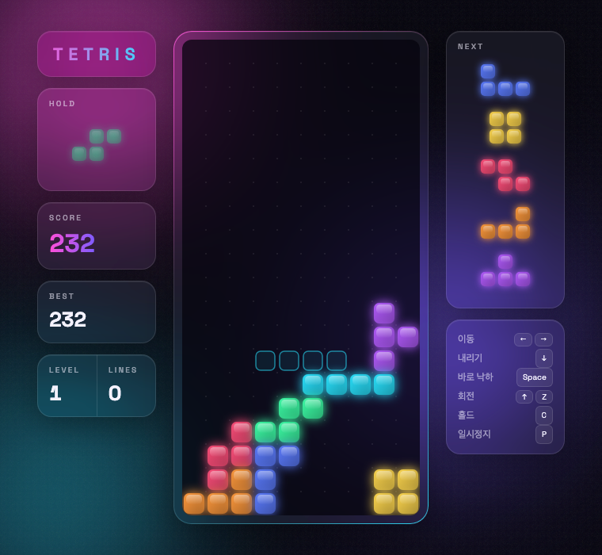

  

  오로라 배경 위에서 즐기는 반투명 유리 질감의 테트리스 
  <b>설치 없이, HTML 파일 하나로 바로 플레이할 수 있어요.</b>

  

  
  
  
  
  

  

## ✨ 특징

| | |
|---|---|
| 🌌 **오로라 배경** | 핑크 · 보라 · 하늘색 빛이 천천히 흐르는 배경 |
| 🧊 **글래스 UI** | 반투명 유리 질감의 패널과 블록 |
| 👻 **고스트 블록** | 블록이 떨어질 자리를 미리 보여줘요 |
| 🔄 **홀드 & 넥스트** | 블록 하나를 보관하고, 다음 블록 5개를 미리 볼 수 있어요 |
| 🎲 **7-bag 랜덤** | 같은 블록만 계속 나오지 않도록 공정하게 섞어요 |
| 🏆 **최고 점수 저장** | 브라우저를 닫아도 최고 기록이 남아요 |
| ⚡ **레벨 시스템** | 10줄을 지울 때마다 레벨이 오르고 속도가 빨라져요 |

## 🎮 조작법

| 동작 | 키 |
|---|---|
| 좌우 이동 | <kbd>←</kbd> <kbd>→</kbd> |
| 천천히 내리기 | <kbd>↓</kbd> |
| 바로 떨어뜨리기 | <kbd>Space</kbd> |
| 회전 | <kbd>↑</kbd> <kbd>X</kbd> (시계방향) · <kbd>Z</kbd> (반시계) |
| 홀드 | <kbd>C</kbd> <kbd>Shift</kbd> |
| 일시정지 | <kbd>P</kbd> <kbd>Esc</kbd> |
| 시작 / 다시 시작 | <kbd>Enter</kbd> |

## 🚀 실행 방법

**온라인에서:** 위의 **지금 플레이하기** 버튼을 누르세요.

**내 컴퓨터에서:** 이 저장소를 내려받은 뒤 `index.html` 파일을 더블클릭하면 브라우저에서 바로 실행돼요.

## 📊 점수 계산

| 지운 줄 | 점수 |
|:---:|:---:|
| 1줄 | 100 × 레벨 |
| 2줄 | 300 × 레벨 |
| 3줄 | 500 × 레벨 |
| 4줄 (테트리스!) | 800 × 레벨 |

천천히 내리면 칸당 1점, 바로 떨어뜨리면 칸당 2점을 더 받아요.

---

  Made by <a href="https://github.com/jisuny-ai">Jisun Yang</a> with Claude Code 💜

